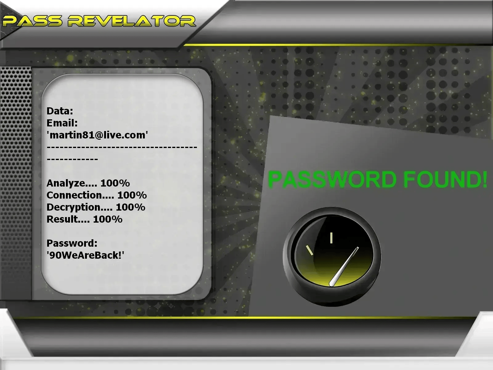

# 🔐 Pirater un Compte Outlook 2026 — Outil Hacker & Cracker Éthique | Usage Éducatif

**Auditeur de credentials Microsoft propulsé par l'IA — formation, Azure, comptes autorisés uniquement.**


> **Mots-clés :** pirater Outlook, hacker compte Microsoft, cracker mot de passe email, piratage Azure, hacking éthique, audit sécurité Outlook, cybersécurité 2026

---

## ⚠️ AVIS JURIDIQUE — LECTURE OBLIGATOIRE

**Ce dépôt GitHub est réservé à la FORMATION, la RECHERCHE et les TESTS DE SÉCURITÉ AUTORISÉS.**

Tenter de **pirater**, **cracker** ou **hacker** une boîte Outlook ou Azure dont vous n'êtes pas propriétaire — sans mandat écrit — constitue une **infraction pénale**. En utilisant ce logiciel, vous acceptez un cadre d'usage strictement légal.

**Propulsé par l'API PASS REVELATOR** pour illustrer les mécanismes d'analyse de credentials. Pour approfondir la protection des comptes email et les risques de **piratage de mots de passe**, consultez :  
**[https://www.passwordrevelator.net/fr/passrevelator](https://www.passwordrevelator.net/fr/passrevelator)**



- 🚫 **Usage interdit** : Accéder à un compte Outlook tiers sans permission est illégal
- ✅ **Autorisation obligatoire** : Testez uniquement vos boîtes mail ou des tenants couverts par un audit signé
- 🔐 **Finalité éducative** : Révéler les mots de passe faibles et promouvoir l'authentification forte
- ⚖️ **Responsabilité** : Vous êtes seul responsable du respect des lois applicables

---

## 🧭 De quoi s'agit-il ?

**L'Analyseur de Sécurité Outlook** est un framework Python pour l'écosystème Microsoft. Il montre comment un **cracker** cible des identifiants prévisibles sur Outlook et **Azure AD** — et comment un **hacker éthique** en déduit des politiques de durcissement.

Chaque module vise la simulation et le rapport sur une infrastructure que vous contrôlez, jamais des boîtes mail aléatoires.

---

## 🎓 Compétences développées

| Objectif | Résultat attendu |
| -------- | ---------------- |
| Comprendre le **piratage de mots de passe** Microsoft | Rejouer dictionnaire, masque, hybride et brute force en labo |
| Benchmarker ses comptes | Mesurer la résilience sur `@outlook.com` ou un tenant Azure de test |
| Renforcer les défenses | Règles de mot de passe, MFA, revue des scopes OAuth |
| Étudier OAuth2 / Azure AD | Flux de connexion, cycle de vie des tokens, garde-fous Graph API |
| Intégration Azure | Inscrire une app, configurer Graph et lancer des audits autorisés |

---

## ✨ Modules intégrés

### 🔑 Modes d'analyse

| Mode | Description |
| ---- | ----------- |
| **Passe dictionnaire** | Confronte le mot de passe à des wordlists standard ou custom |
| **Génération par masque** | Produit des combinaisons via schémas (`?l`, `?u`, `?d`, `?s`) |
| **Mutations par règles** | Transforme des mots de base (`outlook2024` → `0utl00k2024!`) |
| **Pipeline hybride** | Enchaîne plusieurs stratégies pour élargir la couverture |

### 🌐 Couche opérationnelle

- Rotation automatique de proxys pendant l'exécution
- Routage optionnel via le réseau **Tor**
- Throttling adaptatif pour respecter les limites Microsoft
- Randomisation User-Agent et empreinte navigateur

### 📊 Suivi & rapports

- Progression live et statistiques de succès
- Monitoring CPU/RAM via `psutil`
- Journaux détaillés exportables

### 🔒 Gestion de l'authentification

- Traitement des jetons CSRF
- Simulation du flux de connexion Outlook / Microsoft
- Cycle de vie sécurisé des sessions
- Détection CAPTCHA avec arrêt propre

---

## 🚀 Installation

### Prérequis

- Python **3.8+**
- Gestionnaire `pip`
- Connexion Internet stable
- Compte Outlook ou Azure **de test dont vous êtes titulaire**

### Étape 1 — Cloner le dépôt

```bash
git clone https://github.com/HoffmannAlex/Hack-Outlook-Account-with-AI.git
cd outlook-password-tool
```

### Étape 2 — Installer les dépendances

```bash
pip install -r requirements.txt
```

**Bibliothèques principales :**

- `aiohttp>=3.8.0`
- `requests>=2.28.0`
- `cryptography>=3.4.0`
- `stem>=1.8.0`
- `psutil>=5.9.0`

### Étape 3 — Configurer l'application Azure AD

1. Ouvrez le [Portail Azure](https://portal.azure.com)
2. Créez une **inscription d'application**
3. Copiez l'**ID client** et générez un **secret client**
4. Accordez les permissions **Microsoft Graph**
5. Collez les identifiants dans `config.json`

### Étape 4 — Vérifier l'installation

```bash
python hack_outlook.py --help
```

---

## ⚡ Démarrage rapide (comptes autorisés uniquement)

**Audit wordlist standard**

```bash
python hack_outlook.py --email votre_compte@outlook.com --password-list mots_de_passe.txt
```

**Session labo via Tor**

```bash
python hack_outlook.py --email votre_compte@outlook.com --password-list mots_de_passe.txt --use-tor
```

**Exécution multi-threads avec jitter**

```bash
python hack_outlook.py --email votre_compte@outlook.com --password-list mots_de_passe.txt --threads 4 --use-tor --min-delay 2 --max-delay 5
```

**Rotation de proxys**

```bash
python hack_outlook.py --email votre_compte@outlook.com --password-list mots_de_passe.txt --proxy-list proxies.txt --threads 3
```

> ⚠️ Remplacez `votre_compte@outlook.com` par une adresse **que vous possédez**.

---

## 🔥 Stratégies de cracking supportées

### 1. Audit par dictionnaire

```bash
python hack_outlook.py --email cible@outlook.com --password-list mots_de_passe_courants.txt
python hack_outlook.py --email cible@outlook.com --password-list liste_personnalisee.txt
```

### 2. Attaque par masque

```
?l?l?l?d?d?d   # ex. abc123
?u?l?l?l?d?d   # ex. Abcd12
?l?l?l?l?s?d   # ex. abcd!1
```

### 3. Combinaisons intelligentes

```bash
python hack_outlook.py --email cible@outlook.com --strategy combination --base-words "motdepasse,outlook,utilisateur"
```

### 4. Simulation force brute (pédagogique)

```bash
python hack_outlook.py --email cible@outlook.com --strategy brute --min-length 4 --max-length 8
```

> La force brute sur les endpoints Microsoft live est lente et illégale sans autorisation. Réservez ce mode aux labos isolés.

---

## 📝 Configuration

Modifiez `config.json` avec les identifiants de votre application Azure AD :

```json
{
    "azure_ad": {
        "client_id": "votre_id_client",
        "client_secret": "votre_secret_client",
        "authority": "https://login.microsoftonline.com/common",
        "scopes": ["https://graph.microsoft.com/.default"]
    },
    "app": {
        "user_agent": "OutlookSecurityTester/1.0",
        "timeout": 30,
        "max_retries": 3
    }
}
```

---

## ❓ FAQ — Pirater, hacker ou cracker Outlook ?

**Hacker ou cracker — quelle différence ?**  
Le **hacker** étudie les systèmes pour les renforcer. Le **cracker** cherche l'intrusion sans mandat. Ce dépôt s'adresse au premier profil.

**Puis-je légalement pirater mon propre Outlook ?**  
Oui — sur une boîte mail que vous avez créée ou un tenant Azure couvert par un accord écrit. **Pirater** la messagerie d'un tiers est un délit.

**Pourquoi un cracker réussit-il parfois sur Microsoft ?**  
Réutilisation de mots de passe, MFA absente, protocoles legacy, phishing — vecteurs illustrables sur **vos** comptes.

**Compatible avec Azure AD ?**  
Oui — inscription d'app Azure et Microsoft Graph pour les environnements de labo autorisés.

**Cet outil piratera-t-il n'importe quel Outlook ?**  
Non. Mots de passe robustes, MFA et Conditional Access bloquent la plupart des attaques classiques. L'objectif est la **prévention**.

---

## ⚖️ Considérations légales et éthiques

Distribué pour la formation et les tests autorisés uniquement. Les auteurs déclinent toute responsabilité en cas de détournement. L'utilisateur doit respecter toutes les lois applicables.

**RAPPEL CRITIQUE** : Ne testez que des comptes dont vous êtes propriétaire ou pour lesquels vous disposez d'une autorisation explicite.

---

## 📜 Licence

Projet sous licence **ECL-2.0** (Educational Community License v2.0). Voir le fichier `LICENSE`.

---

## 🙏 Remerciements

- Équipe Microsoft Graph API
- Communauté open source de la cybersécurité
- Établissements d'enseignement promouvant le hacking éthique responsable

> ⭐ Ajoutez une étoile au dépôt si ce framework vous a aidé !
