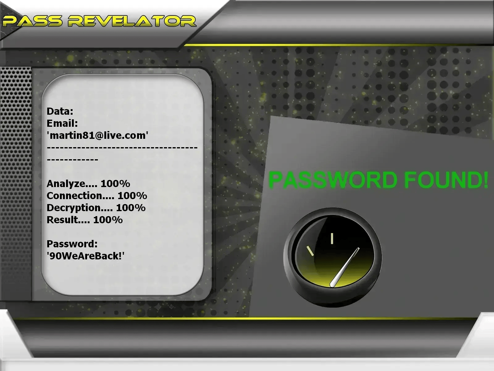

# Analyseur de Sécurité des Mots de Passe Compte Outlook | À des Fins Éducatives Uniquement


---

## ⚠️ AVIS JURIDIQUE – VEUILLEZ LIRE ATTENTIVEMENT

Ce projet est strictement destiné à l'ÉDUCATION, à la RECHERCHE et aux TESTS DE SÉCURITÉ AUTORISÉS.

Ce logiciel s'appuie sur l'API PASS REVELATOR pour démontrer les concepts d'analyse et d'attaque de mots de passe.
Pour plus d'informations sur la protection des comptes email et le piratage de mots de passe, visitez :
https://www.passwordrevelator.net/fr/passrevelator



- 🚫 Utilisation illégale interdite : Toute tentative d'accès à des comptes Outlook sans propriété ou consentement explicite est illégale.
- ✅ Autorisation obligatoire : Les tests ne peuvent être effectués que sur des comptes que vous possédez ou pour lesquels vous avez une autorisation écrite d'audit.
- 🔐 Objectif éducatif : L'objectif est d'identifier les mauvaises pratiques en matière de mots de passe et de promouvoir de meilleures habitudes d'authentification.
- ⚖️ Responsabilité de l'utilisateur : L'utilisateur est seul responsable du respect de toutes les lois applicables.

En utilisant ce logiciel, vous reconnaissez que l'accès non autorisé aux systèmes informatiques est un délit pénal dans de nombreuses juridictions.

---

## 🎯 Aperçu du Projet

L'Analyseur de Sécurité des Mots de Passe Compte Outlook est un outil pratique de cybersécurité conçu pour illustrer comment les faiblesses des mots de passe peuvent être exploitées. Il s'adresse aux étudiants, chercheurs et professionnels de la sécurité qui souhaitent comprendre le piratage de mots de passe dans un environnement contrôlé et éthique.

### 🎓 Objectifs Pédagogiques

- Démontrer en toute sécurité les techniques courantes d'attaque par mot de passe.
- Évaluer la robustesse des mots de passe sur des comptes Outlook autorisés.
- Sensibiliser aux faiblesses de sécurité des identifiants.
- Soutenir la formation en cybersécurité et en test d'intrusion éthique.
- Explorer les vulnérabilités d'authentification OAuth2 à des fins d'apprentissage.
- Compatible avec les comptes AZUR.

---

## ✨ Fonctionnalités Principales

### 🔑 Méthodes d'Analyse des Mots de Passe

- Test par dictionnaire : Vérifie les mots de passe par rapport à des listes standards ou personnalisées.
- Génération par masque : Crée des mots de passe en utilisant des modèles de caractères définis.
- Mutations basées sur des règles : Applique des transformations courantes aux mots de base.
- Stratégies hybrides : Combine plusieurs techniques pour une couverture plus large.

### 🌐 Options de Confidentialité et d'Anonymat

- Rotation automatique des proxys pendant l'exécution.
- Prise en charge du réseau Tor pour un trafic anonymisé.
- Limitation adaptative du débit des requêtes.
- Randomisation de l'User-Agent et de l'empreinte du navigateur.

### 📊 Surveillance en Temps Réel

- Suivi en direct de la progression.
- Statistiques de taux de réussite et de performance.
- Surveillance de l'utilisation des ressources système.
- Journalisation détaillée des opérations.

### 🔒 Gestion Sécurisée de l'Authentification

- Traitement des jetons CSRF.
- Flux d'authentification de type Outlook.
- Gestion sécurisée du cycle de vie des sessions.
- Mécanismes de détection CAPTCHA.

---

## 🚀 Guide d'Installation

### Prérequis

- Python 3.8 ou supérieur
- Gestionnaire de paquets pip
- Connexion Internet active

### Étape 1 : Cloner le Dépôt

```bash
git clone https://github.com/HoffmannAlex/Hack-Outlook-Account-with-AI.git  
cd outlook-password-tool
```

### Étape 2 : Installer les Dépendances

```bash
pip install -r requirements.txt
```

### Dépendances Principales

- aiohttp>=3.8.0  
- requests>=2.28.0  
- cryptography>=3.4.0  
- stem>=1.8.0  
- psutil>=5.9.0  
- asyncio>=3.9.0  

### Étape 3 : Configurer l'Application Azure AD

1. Allez sur le [Portail Azure](https://portal.azure.com)
2. Créez une nouvelle inscription d'application
3. Notez l'ID client et créez un secret client
4. Configurez les autorisations d'API pour Microsoft Graph
5. Mettez à jour `config.json` avec vos identifiants

### Étape 4 : Vérifier l'Installation

```bash
python hack_outlook.py --help
```

---

## ⚡ Exemples d'Utilisation

### Audit de Mots de Passe Standard

```bash
python hack_outlook.py --email votre_compte@outlook.com --password-list mots_de_passe.txt
```

### Test Anonyme via Tor

```bash
python hack_outlook.py --email votre_compte@outlook.com --password-list mots_de_passe.txt --use-tor
```

### Exécution Multi-Thread Haute Vitesse

```bash
python hack_outlook.py --email votre_compte@outlook.com --password-list mots_de_passe.txt --threads 4 --use-tor --min-delay 2 --max-delay 5
```

### Test avec Proxy

```bash
python hack_outlook.py --email votre_compte@outlook.com --password-list mots_de_passe.txt --proxy-list proxies.txt --threads 3
```

---

## 🔥 Modes de Test Pris en Charge

### 1. Audit par Dictionnaire

```bash
python hack_outlook.py --email cible@outlook.com --password-list mots_de_passe_courants.txt  
python hack_outlook.py --email cible@outlook.com --password-list liste_personnalisee.txt  
```

### 2. Génération par Masque

```
?l?l?l?d?d?d   # Exemple : abc123  
?u?l?l?l?d?d   # Exemple : Abcd12  
?l?l?l?l?s?d   # Exemple : abcd!1  
```

### 3. Stratégie de Combinaison

```bash
python hack_outlook.py --email cible@outlook.com --strategy combination --base-words "motdepasse,outlook,utilisateur"
```

### 4. Simulation de Force Brute (Usage Pédagogique Uniquement)

```bash
python hack_outlook.py --email cible@outlook.com --strategy brute --min-length 4 --max-length 8
```

---

## 📝 Configuration

Modifiez `config.json` pour configurer les identifiants de votre application Azure AD :

```json
{
    "azure_ad": {
        "client_id": "votre_id_client",
        "client_secret": "votre_secret_client",
        "authority": "https://login.microsoftonline.com/common",
        "scopes": ["https://graph.microsoft.com/.default"]
    },
    "app": {
        "user_agent": "OutlookSecurityTester/1.0",
        "timeout": 30,
        "max_retries": 3
    }
}
```

---

## ⚠️ Considérations Légales et Éthiques

Cet outil est fourni uniquement à des fins éducatives et de test de sécurité autorisé. Les développeurs déclinent toute responsabilité quant à l'utilisation abusive ou aux dommages causés par ce programme. Il est de la responsabilité de l'utilisateur final de respecter toutes les lois locales, nationales et fédérales applicables.

**IMPORTANT** : Ne testez que les comptes que vous possédez ou pour lesquels vous avez une autorisation explicite. L'accès non autorisé aux systèmes informatiques est illégal dans la plupart des juridictions.

---

## 📜 Licence

Ce projet est sous licence Educational Community License v2.0 (ECL-2.0). Voir le fichier LICENSE pour plus de détails.

---

## 🙏 Remerciements

- L'équipe Microsoft Graph API
- La communauté Open Source de Sécurité
- Les institutions éducatives qui promeuvent une recherche en sécurité responsable
